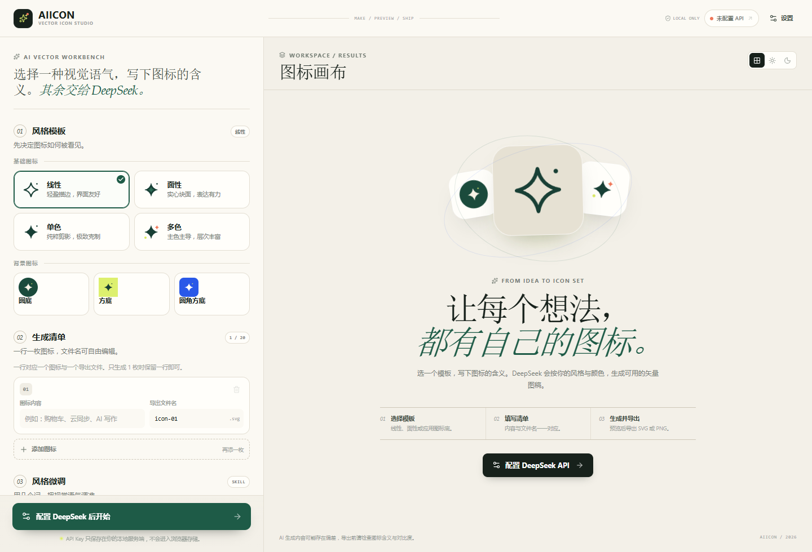

# AIICON · AI 图标生成器

本地优先的 AI 矢量图标工作台。配置 DeepSeek API Key 与模型，选择模板 Skill 并微调关键词、主色、背景色与圆角，批量生成统一风格的 SVG 图标，预览后导出 SVG / PNG / ZIP。

当前为 **MVP v0.1**，已在 Chromium 与 Windows Electron 桌面应用中完成端到端验证。




## 功能

- **7 套模板与 Skill**：线性、面性、单色、多色、圆底 + icon、方底 + icon、圆角方底 + icon。
- **模板 Skill 微调**：每套模板有只读核心规则与推荐关键词，支持最多 8 个自定义关键词，并按模板记忆。
- **可控配色**：主色 / 背景色可指定 HEX、使用取色器，或留空由 AI 结合语义和对比度规划；背景模板会提示低对比度。
- **批量生成**：1～20 个任务共用视觉设置；单枚直接生成，多枚先确认；并发 3，逐枚显示进度。
- **失败与取消**：支持取消批次、部分成功、单枚重试、失败项批量重试，最多每枚 2 次模型调用（含一次自动修复）。
- **安全 SVG**：服务端严格白名单校验、颜色/背景/圆角校验与自动修复；前端二次清洗并使用 `` / Blob 渲染。
- **预览与导出**：透明棋盘/浅色/深色检查底、详情与 SVG 源码、复制 SVG、单枚 SVG/PNG、批量 ZIP（SVG/PNG 双目录）。
- **本地配置**：Key 保存在本地服务端并加密，浏览器只看到掩码；草稿保存在 `localStorage`，生成结果仅存内存。
- **UI**：桌面优先的工作台布局、键盘焦点管理、响应式降级与中文文案。

## 技术栈

- 前端：Vue 3、TypeScript、Vite、Pinia、DOMPurify、JSZip、Lucide。
- 本地 BFF：Node.js、Fastify、Zod、`saxes`（严格 SVG 安全解析）。
- 测试：Vitest（共享工具、配置保险箱、SVG Guard、Prompt、生成服务）。

## 快速开始

要求：**Node.js ≥ 22**、**pnpm 11**。

```bash
pnpm install
pnpm dev
```

打开：

- Web：<http://127.0.0.1:5173>
- API：<http://127.0.0.1:8787>

首次使用点击右上角「设置」或「配置 DeepSeek API」，填入 Key 和模型。默认模型为 `deepseek-flash`，也可选择 `deepseek-v4-pro` 或输入自定义模型名。

### 生产构建

```bash
pnpm build
pnpm start
```

打开 <http://127.0.0.1:8787>。生产模式下 Fastify 同时托管前端静态文件和 API。

> 重新构建前端后需要重启 `pnpm start`，因为静态文件列表在服务启动时注册。

## Windows 桌面安装包

已生成可安装的 NSIS 安装程序：

```text
release/AIICON-Setup-0.1.2.exe
```

双击安装后可选择安装目录，安装器会创建桌面与开始菜单快捷方式。当前构建**未做代码签名**，Windows SmartScreen 可能显示“未知发布者”；这是未签名本地构建的正常提示，请仅在确认文件来源后运行。

桌面版特点：

- 无系统原生标题栏，工具右上角提供自定义的 **最小化 / 全屏·半屏 / 关闭** 三个按钮。
- 顶部工作区可直接拖动窗口；窗口支持系统缩放与最大化吸附。
- Electron 主进程内嵌本地 Fastify BFF（随机 `127.0.0.1` 端口），不需要用户另外启动服务。
- 导出时显示 Windows 原生保存对话框；批量导出为 ZIP。
- 单实例运行，关闭窗口时同步停止本地服务。
- 桌面配置保存在 `%APPDATA%\AIICON Desktop\config`，与 Web 模式的 `%APPDATA%\AIicon` 相互独立；卸载默认保留数据。

开发/重新打包：

```bash
# 启动带窗口的桌面开发版本（会先构建 Web 与 BFF）
pnpm desktop:dev

# 生成安装包：先构建 Web/BFF，再构建 Electron 主进程并调用 electron-builder
pnpm desktop:package
```

构建产物：

```text
release/AIICON-Setup-0.1.2.exe   # 安装器
release/win-unpacked/AIICON.exe  # 免安装运行目录
```

> 首次安装/构建 Electron 需要下载约 160 MB 运行时；本环境已使用 npmmirror 完成下载。`pnpm-workspace.yaml` 中对 `@electron/get` 的版本覆盖用于修复 electron-builder 当前版本与下载器的兼容问题。

## 配置与安全

Web/BFF 模式会在以下位置保存加密后的 Key、模型与配置：

- Windows：`%APPDATA%\AIicon`
- macOS：`~/Library/Application Support/AIicon`
- Linux：`~/.config/aiicon`

Windows 桌面版使用自己的 Electron 用户目录，配置实际位于 `%APPDATA%\AIICON Desktop\config`，与 Web 模式相互独立。

Web/BFF 模式可以通过环境变量覆盖：

```bash
# 可选：自定义配置目录
AIICON_CONFIG_DIR=./.data

# 可选：环境变量中的 Key 优先级最高，此时 UI 中的 Key 只读
DEEPSEEK_API_KEY=sk-...

# 可选：DeepSeek 兼容网关 / 模型
DEEPSEEK_BASE_URL=https://api.deepseek.com
DEEPSEEK_MODEL=deepseek-flash

# 可选：服务端口与监听地址
HOST=127.0.0.1
PORT=8787
```

复制 `.env.example` 为 `.env` 即可使用。环境变量方式适合本地临时使用，但 `.env` 本身是明文，请勿提交真实 Key。

安全边界：

- API Key 通过同源本地 BFF 使用，不会写入浏览器持久存储。
- Key 使用 AES-256-GCM 加密并保存到本地文件；该措施用于降低误读/误提交风险，不防御已取得本机账户权限的攻击者。
- 所有 AI SVG 在服务端通过元素/属性白名单、体积、样式与颜色校验后才返回前端。
- 默认监听 `127.0.0.1`；这是一个单用户本地工具，未实现登录、限流和多租户隔离，**不要直接暴露到公网**。

## 本地 Mock 演示（无需消耗 API 额度）

仓库包含一个开发用的 DeepSeek Mock，用于 UI 与导出流程验证：

```bash
# 终端 1
node scripts/mock-deepseek.mjs

# 终端 2（PowerShell）
$env:AIICON_CONFIG_DIR=".data-demo"
$env:DEEPSEEK_BASE_URL="http://127.0.0.1:9999"
$env:PORT="8790"
pnpm start
```

打开 <http://127.0.0.1:8790> 后在设置中填入任意长度合法的 Key（例如 `sk-local-mock-12345678`）即可生成演示图标。Mock 只用于开发验证，不参与生产逻辑。

## 常用命令

```bash
pnpm dev              # API + Vite 开发服务
pnpm build            # 构建前端与服务端
pnpm start            # 启动生产 Web 服务
pnpm desktop:dev      # 构建并启动 Electron 桌面窗口
pnpm desktop:package  # 构建 Windows NSIS 安装包
pnpm typecheck        # 所有包的 TypeScript 检查
pnpm test             # 共享包 + 服务端测试（44 个用例）
pnpm mock:deepseek    # 启动本地 Mock
```

## 目录结构

```text
AIicon/
├─ apps/
│  ├─ web/                # Vue 3 工作台
│  │  └─ src/
│  │     ├─ components/   # UI / 设置 / 工作台 / 结果
│  │     ├─ stores/       # config / workspace / ui
│  │     ├─ composables/  # 队列、草稿、预览、toast
│  │     ├─ utils/        # 安全 SVG、导出
│  │     └─ App.vue
│  ├─ server/             # Fastify BFF
│  │  ├─ src/services/    # vault / DeepSeek / prompt / SVG guard
│  │  └─ test/
│  └─ desktop/            # Electron 主进程、preload、窗口控制、安装包配置
│     ├─ src/
│     └─ build/icon.ico
├─ packages/shared/       # 模板、类型、Zod、颜色、文件名
├─ scripts/mock-deepseek.mjs
├─ docs/
│  ├─ requirements.md
│  └─ execution-plan.md
└─ .env.example
```

## 更新记录

### v0.1.2

- **修复“面性”模板在多关键词（如“块面、负空间、圆润、微立体”）下连续校验失败的问题**。
- 面性模板现在允许最多 3 个同色系明暗色值或中性高光，修复了校验器与模板说明不一致的问题。
- 自动修复请求增加“可舍弃冲突风格关键词、优先输出更简单合法图标”的明确指令。
- 成功结果会记录“首次结果经自动修复”的原因，便于判断关键词与校验规则的冲突。
- 补充同色系/色彩回归测试，共 44 个测试。

### v0.1.1

- 新增 Windows x64 NSIS 安装包与无边框 Electron 桌面窗口。
- 工具内自定义最小化、全屏/半屏、关闭三个窗口按钮，替代系统原生标题栏。
- 桌面版内嵌本地 Fastify BFF，使用随机本机端口；支持原生保存对话框和单实例运行。
- **修复真实 DeepSeek 生成时“模型未返回有效内容”的问题**：DeepSeek 当前默认开启 thinking 模式，推理 token 可能耗尽输出预算并导致 `content` 为空。请求现在显式发送 `thinking: { type: "disabled" }`，同时保留 JSON Output。
- 空响应错误现在附带 `finish_reason`、token 与 reasoning 长度等脱敏诊断信息。

### v0.1.0

- 首个 Web MVP：7 套模板、批量生成、预览、SVG/PNG/ZIP 导出、SVG 安全校验与本地加密配置。

## 已知限制

- 生成结果只存于当前页面内存，刷新会丢失；草稿会保留。
- 不包含 AI 修复后的手动 SVG 编辑、图标历史、云同步、团队协作。
- DeepSeek 文本模型生成 SVG 的质量与延迟取决于所选模型与网络；系统提供一次自动修复与手动重试。
- 设计上仅面向本机单用户；公网部署前必须补充认证、限流、密钥隔离与访问控制。
- Windows 安装包未进行代码签名，SmartScreen 可能提示“未知发布者”；正式分发需配置代码签名证书。
- 图标内容会发送至 DeepSeek，请勿输入敏感信息。

## 文档

- [产品需求文档](./docs/requirements.md)
- [执行计划](./docs/execution-plan.md)

模型与接口以 [DeepSeek 官方 API 文档](https://api-docs.deepseek.com/) 为准；模型列表可通过 UI 自定义，不硬编码为唯一可选项。


